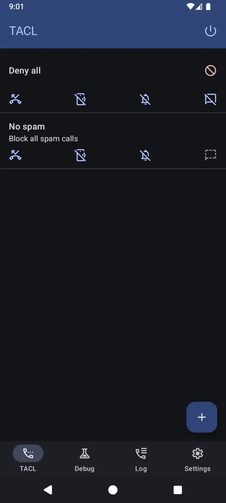
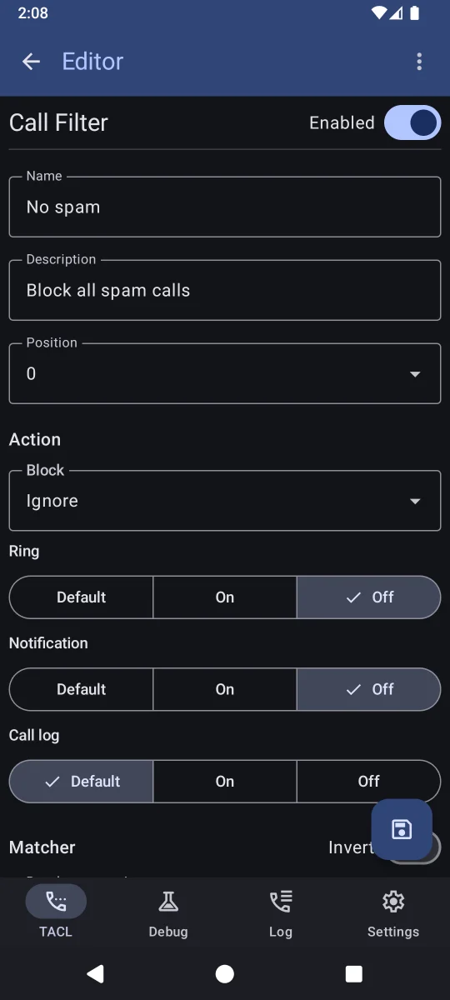
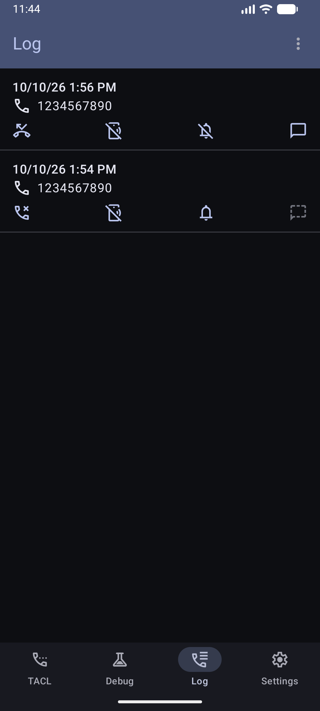

# TACL

***Telephone Access Control List (TACL)***

TACL is a powerful call filtering app for Android power users. It allows you to define complex rules
to intercept and manage incoming calls, ensuring you only hear from the people you want.

  

> [!IMPORTANT]
> **Important Compatibility Note:**  
> TACL is based on Android's `CallScreeningService` and will not work if blocked by the phone manufacturer, custom ROM, or certain default phone apps.
> It is also required that the necessary system roles and permissions are granted — see the [Permissions](docs/Permissions.md) guide for details.

> [!NOTE]
> **Testing Scope:**  
> The app is mainly tested against Android Virtual Devices (AVD) and a small selection of available real-life phones.
> For issues caused by a specific device or ROM, no support can be given.

## Key Features

- **Regex Matching**: Match incoming numbers using powerful regular expressions.
- **Custom Actions**: Choose whether to ignore, hang up, silence, or hide calls from your log.
- **Priority-based Filtering**: Rules are applied in a specific order, allowing for fine-grained control.
- **Privacy First**: No internet access, no tracking, all data stays on your device. For more details about permissions and their usage see [Permissions](docs/Permissions.md)

## Getting Started

For detailed instructions on how to install TACL, please see
the [Installation Guide](docs/InstallationGuide.md).

### Basic Usage

1. Open TACL and grant the required **Call Screening** role.
2. Click the **+** button to create a new filter.
3. Define a **Matcher** (e.g., a regex for a specific area code).
4. Define an **Action** (e.g., Block + Hangup).
5. Save and ensure the filter is enabled.

For more details on what each action does, see [Call Filter Actions](docs/FilterActions.md).

## Screenshots

|  |  |  |
|---------------------------------------------------------------------------------------------------------------------|-------------------------------------------------------------------------------------------------------------------------|----------------------------------------------------------------------------------------------------------------------|

## License

This project is licensed under GPLv3 (see [LICENSE](./LICENSE)).  
For used third party licenses see [THIRD_PARTY_LICENSES.md](./THIRD_PARTY_LICENSES.md).
